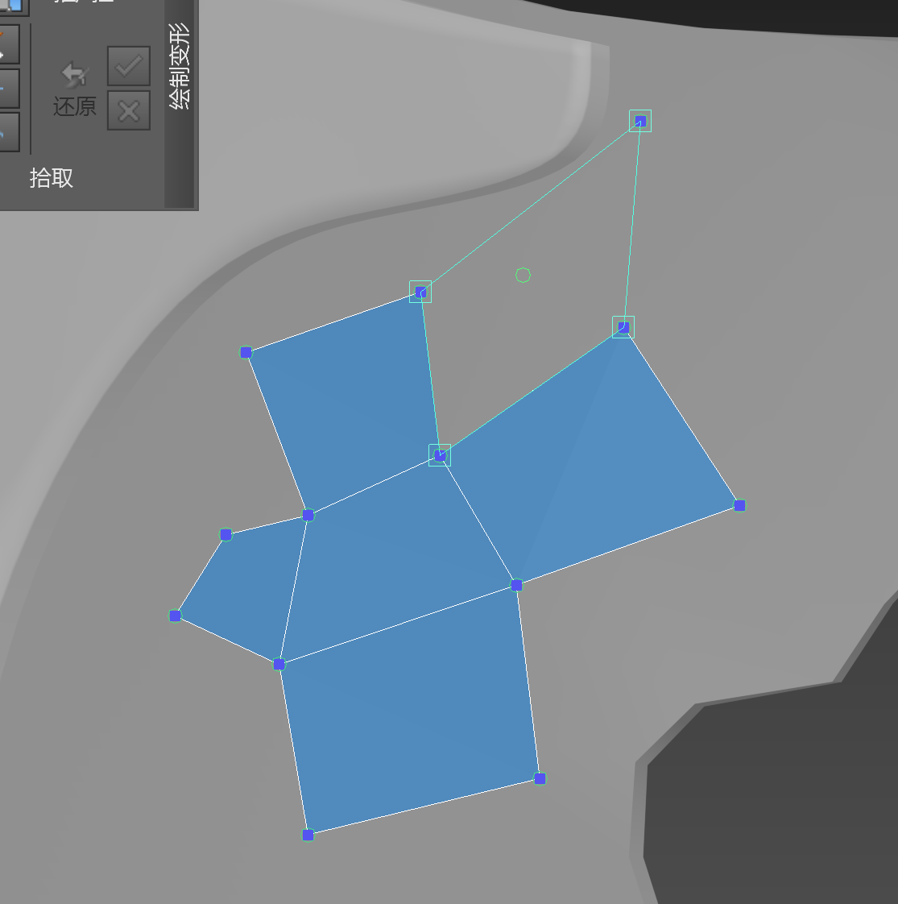
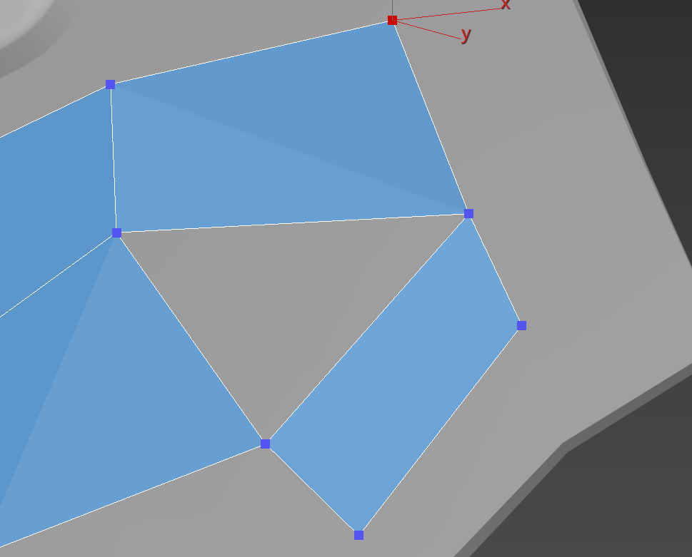
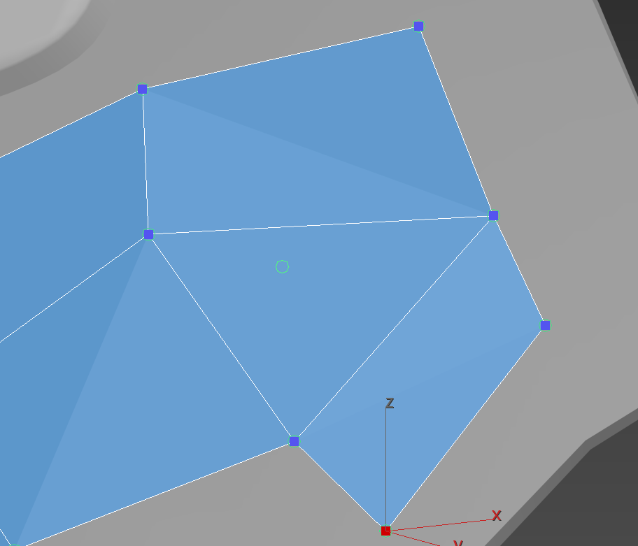

# MayaQuadDraw_Max2024

[中文](README.md) · [English](README.en.md) · [Download latest release](https://github.com/amanter-Zthen/MayaQuadDraw_Max2024/releases/latest) · [FAQ](docs/FAQ.md) · [Report a problem](https://github.com/amanter-Zthen/MayaQuadDraw_Max2024/issues/new/choose)

**MQD Polygon Drawing** (MQD多边形绘制) is a **Maya-style polygon drawing and manual retopology plugin for Autodesk 3ds Max 2024**. It brings four separate Max polygon-drawing modules into a unified interaction workflow, reducing tool switching so artists can keep their attention on the model and maintain a continuous creative flow.

MQD uses MAXScript and native C++ plugins to place vertices on a reference surface, preview and create faces, and adjust vertices, edges and faces. It is an interactive surface-modeling tool, not an automatic whole-mesh remesher.

Source code is available under a custom free-use license. **Use in paid modeling work and company projects is allowed; selling or charging for the plugin or modified versions, or incorporating its code into a paid plugin/software product, is not.** See [LICENSE](LICENSE). This is not an MIT/GPL or OSI-approved open-source license.

## Requirements

| Item | Supported scope |
|---|---|
| Host | Autodesk 3ds Max 2024, 64-bit |
| Operating system | Windows |
| Work mesh | An Editable Poly object |
| Reference | A separate surface selected with native PolyDraw Pick |
| UI and testing | Chinese parameter UI; interaction testing used Chinese Max |
| Maya installation | Not required |

Other Max major versions require a matching SDK build and separate validation. The included DLX files should not be assumed compatible with them.

## Download and install

1. Save your scene. If upgrading, restart Max and do not activate MQD before installing, so its old native plugins remain unloaded.
2. Download the `.mzp` asset from the [latest release](https://github.com/amanter-Zthen/MayaQuadDraw_Max2024/releases/latest), drag it into a Max viewport, then restart Max after installation. GitHub's Source code ZIP is for development, not the MZP installer.
3. In the Hotkey Editor, find category **MQD Tools**, action **MQD Quad Draw**. Assign **Ctrl+Shift+Q** or another available shortcut; the installer does not replace your existing bindings.
4. Select one Editable Poly work mesh, choose a different reference object through PolyDraw **Pick**, then activate MQD.

Use a scene copy for initial checks. The v1.0.0 installer has static/package validation; a fresh clean-environment interactive installation has not been revalidated. The shipped runtime retains the tested baseline. [Installation details in Chinese](docs/INSTALL.md).

## Main controls

| Action | Result |
|---|---|
| Click an empty part of the reference surface | Place a vertex |
| Drag a recognized vertex, edge or face | Move the component on the reference surface |
| Hold Shift, hover, then click | Preview/create a quad or fill a closed triangle hole |
| Shift-drag a boundary | Extend one boundary edge |
| Ctrl+Shift-drag a boundary | Loop extension |
| Ctrl-click an edge | Insert a loop |
| Ctrl+Alt-click a component | Delete that vertex, edge or face |
| Shift-drag an internal region | Relax; brush feel still has room for improvement |
| Right-click or leave the tool | End MQD and restore the captured state |

Quad creation chooses one nearest-four set. If that set fails the geometry/topology checks, it produces no preview rather than substituting a more distant combination. Commit revalidates the displayed IDs and prepared winding. Additional checks cover surface layers, duplicate faces, occupied edges, local crossings and the final face direction.

## Workflow examples and practical benefits

MQD brings a **Maya-inspired, continuous drawing workflow to an existing Max scene**: place points, inspect a preview, create a face, adjust components and extend the mesh. Its gestures and face-creation rules are adapted to Max, rather than being a one-to-one copy of Maya.

### Inspect the connection before creating a quad

Hold **Shift** and hover to inspect the candidate outline and its four corners, then click to create the face. Release Shift to continue placing points or dragging vertices, edges and faces. The intended benefit is fewer tool changes while deciding the next part of the topology.

### Fill a closed triangle hole without leaving the tool

**Before:** three existing edges enclose a triangular gap.

**After:** hold **Shift** over the hole, inspect the candidate and click to fill it, then continue drawing. This operation requires a closed three-edge hole; it does not create a triangle from any three loose points.

These are actual-use screenshots with a slight viewpoint change between the before/after images. They illustrate preview and fill behavior, not interaction-speed benchmarks.

### What MQD adds to a Max workflow

- **Less switching:** common point placement, component adjustment and boundary extension operations share one interaction workflow.
- **Feedback before committing:** component highlighting and a Shift candidate preview show the intended connection. Commit revalidates the same vertex set.
- **Native surface controls:** Max PolyDraw's numeric **Offset** remains available for drawing at a distance from the reference surface, alongside the existing Pick workflow.
- **Max-oriented candidate rules:** an invalid nearest-four set produces no candidate instead of a substitute using more distant points; additional checks cover orientation, duplicate faces and local crossings.

Surface offset is **not exclusive to MQD**: Maya Quad Draw also has Surface Offset. Previewing faces and filling triangular holes are Maya-inspired workflow features, not claims of invention. MQD is not a complete replacement for Maya Quad Draw, and Relax feel still has room for improvement. See the [bilingual workflow comparison](docs/WORKFLOW_COMPARISON.md) for trade-offs, official references and implementation pointers.

## Versions and validation

The first public product release is **v1.0.0**. Its native bridge identifies as `0.17.6-max2024-v16-unified-stepbuild`; the Relax implementation is `0.20.0-max2024-sdk-paint-deform-dense-stroke`. Product and internal implementation version numbers serve different purposes.

The baseline completed **81 Max self-test checks with zero failures** on 2026-09-16, followed by user confirmation of normal operation. Portable tests cover 121 candidate-rule checks and 71 depth-numerics checks. These are scoped regression results, not a guarantee for every mesh. [Testing details](docs/TESTING.md).

## Source and development

- `payload/MayaQuadDraw_Max2024/runtime`: MAXScript runtime.
- `source/native`: C++ sources and Visual Studio projects.
- `tests`: portable rule tests and Max runtime self-test.
- `tools`: native build, package validation and release packaging scripts.

V16 includes the V15 input-bridge source as a build dependency. Installation deploys V16 and Relax V20 only. Supply your own licensed Max installation and SDK; third-party SDK files are not distributed. See [build instructions](docs/BUILD.md) and [third-party notices](THIRD_PARTY_NOTICES.md).

## Feedback and contributions

Please send useful findings back: report bugs or suggestions through [Issues](https://github.com/amanter-Zthen/MayaQuadDraw_Max2024/issues/new/choose), or fork the repository and open a [Pull Request](https://github.com/amanter-Zthen/MayaQuadDraw_Max2024/pulls) with changes and test results. Feedback and upstream contributions are voluntary. Only share scenes and logs you have permission to publish; MQD does not automatically collect or upload them. [Contribution guide](CONTRIBUTING.md).

The `main` branch may receive documentation and development changes after a release. Use version tags and [Releases](https://github.com/amanter-Zthen/MayaQuadDraw_Max2024/releases) for fixed builds; see the [changelog](CHANGELOG.md). MQD is independent of Autodesk and is not an official Maya or 3ds Max product.
